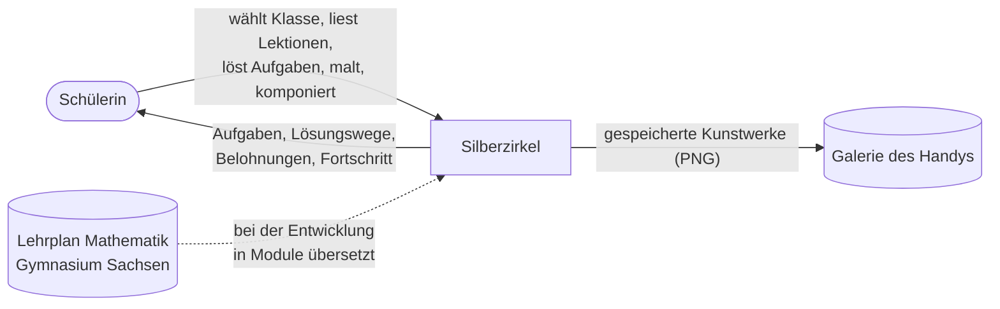
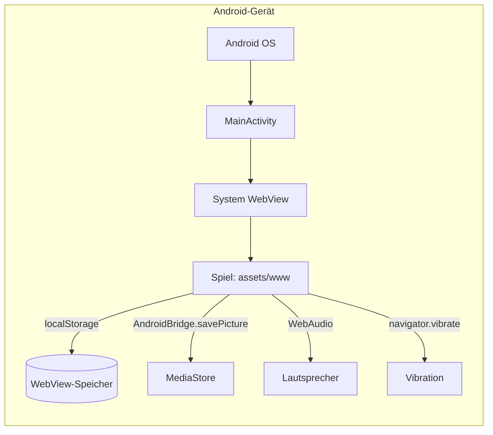
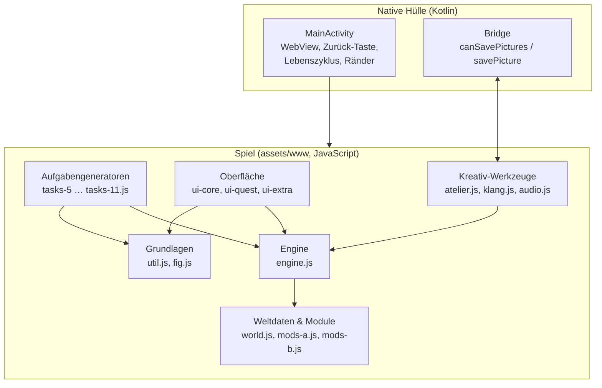
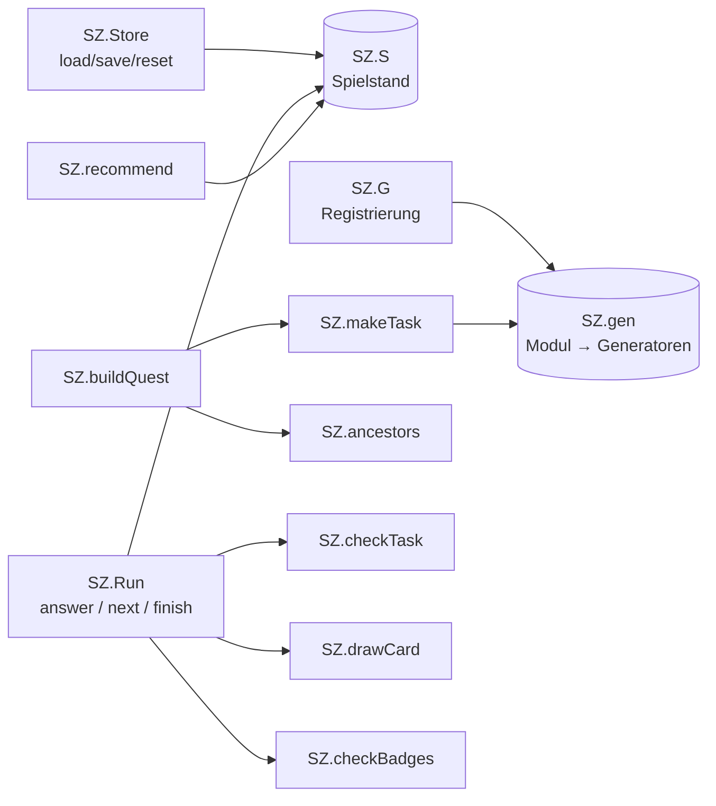
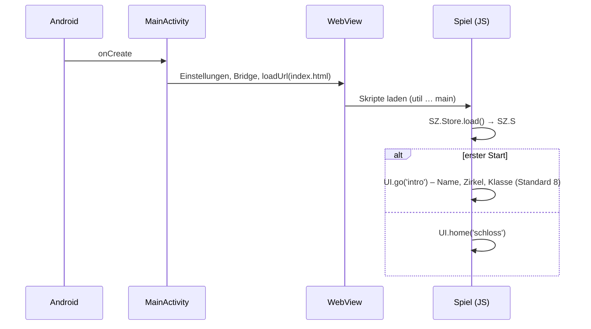
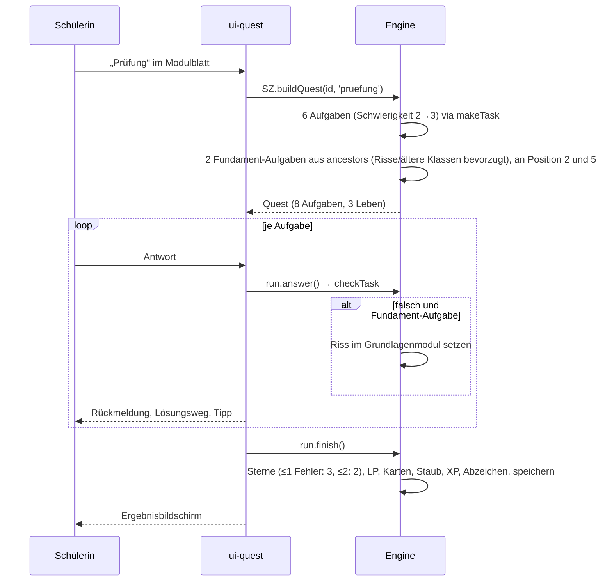
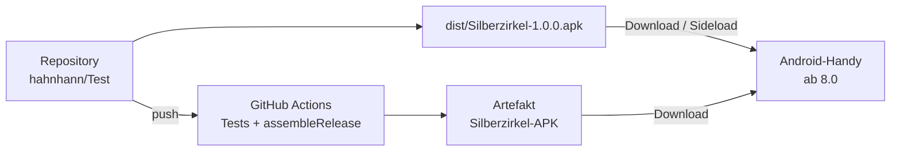
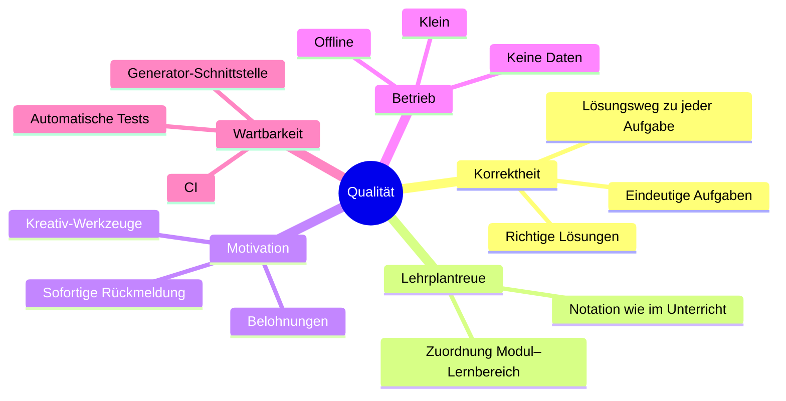

# Silberzirkel – Architekturdokumentation nach arc42

Gliederung nach der arc42-Vorlage (Version 8). Diagramme in Mermaid (werden auf GitHub
dargestellt). Entstehungsgeschichte und Rahmenbedingungen: [`ENTWICKLUNG.md`](ENTWICKLUNG.md).

| | |
|---|---|
| System | Silberzirkel – Akademie der Zahlenmagie (Android-App) |
| Version | 1.0.0 |
| Stand | November 2026 |

---

## 1. Einführung und Ziele

### 1.1 Aufgabenstellung

Silberzirkel ist ein Mathematik-Lernspiel für Schülerinnen und Schüler des **Gymnasiums in
Sachsen** (Klassen 5 bis 11/12). Es bildet den **sächsischen Lehrplan Mathematik** als
„**Gebäude der Mathematik**“ ab: ein Schloss aus Fundament und fünf Türmen, dessen Stockwerke die
Klassenstufen sind. Jedes Lernmodul ruht auf früheren Modulen; Übungen greifen diese Grundlagen
immer wieder auf. Die Spielwelt ist eine eigene Zauberakademie, angelehnt an
Zauberschul-Geschichten. Ein Belohnungssystem mit künstlerisch-musischen Werkzeugen
(Kaleidoskop-Atelier, Klangkammer) motiviert besonders kreative Lernende.

Wesentliche Funktionen:

| Funktion | Beschreibung |
|---|---|
| Klassenwahl | Klasse 5–11/12 wählbar, Standard Klasse 8 |
| Schloss | Übersicht aller 70 Module nach Turm (Fachgebiet) und Stockwerk (Klasse) mit Sternen und Rissen |
| Schriftrolle | Lektion je Modul: Idee, Definitionen, Sätze mit Begründung, Beispiel, Stolperfalle, „Kunst & Klang“ |
| Übung | 6 Aufgaben steigender Schwierigkeit, davon 1–2 Fundament-Aufgaben aus Vorgängermodulen |
| Prüfung | 8 Aufgaben (davon 2 Fundament-Aufgaben), 3 Leben; bestanden → 2–3 Sterne und Leistungspunkte |
| Rabenpost | Tägliche Wiederholung (5 Aufgaben aus verschiedenen Modulen), Serien-Bonus |
| Risse | Fehler bei einer Fundament-Aufgabe markieren das Grundlagenmodul; Reparatur durch Üben |
| Belohnungen | Sternenstaub, Erfahrung/Ränge, Sammelkarten (Mathematiker), Abzeichen, Laden |
| Atelier / Klangkammer | Freischaltbare Kreativ-Werkzeuge (Kaleidoskop-Malen, 16-Schritt-Sequencer) |
| Studienbuch | Leistungspunkte je Klasse, Statistik, Einstellungen |

### 1.2 Qualitätsziele

| Priorität | Qualitätsziel | Bedeutung |
|---|---|---|
| 1 | **Fachliche Korrektheit** | Jede Aufgabe ist mathematisch richtig, eindeutig und hat einen nachvollziehbaren Lösungsweg. |
| 2 | **Lehrplantreue** | Inhalte entsprechen den Lernbereichen des sächsischen Lehrplans; Zuordnung ist nachweisbar. |
| 3 | **Motivation / Bedienbarkeit** | Für 10- bis 18-Jährige ansprechend, einfach mit einer Hand bedienbar, sofortige Rückmeldung. |
| 4 | **Offline und datensparsam** | Läuft vollständig ohne Netz, ohne KI, ohne Datenerhebung. |
| 5 | **Wartbarkeit / Erweiterbarkeit** | Neue Aufgaben und Module ohne Eingriff in Engine oder Oberfläche ergänzbar; Tests ohne Gerät. |

### 1.3 Stakeholder

| Rolle | Erwartung |
|---|---|
| Schülerin (Hauptnutzerin) | Spannendes, schönes Spiel; Erfolgserlebnisse; Verständnis statt Auswendiglernen |
| Eltern / Auftraggeber | Lehrplangerechte Inhalte, keine Werbung, keine Daten, einfache Installation |
| Lehrkräfte (indirekt) | Korrekte Fachsprache und Notation wie im Unterricht |
| Entwickler (künftig) | Verständliche Struktur, Tests, reproduzierbarer Build |

---

## 2. Randbedingungen

### 2.1 Technische Randbedingungen

| Randbedingung | Erläuterung |
|---|---|
| Android ≥ 8.0 (API 26) | Mindestversion; Ziel-API 36 |
| Keine KI, keine Server | Aufgaben ausschließlich durch lokale, deterministische Generatoren |
| Keine Internet-Berechtigung | Nur `VIBRATE` im Manifest |
| System-WebView | Spiel läuft in der auf dem Gerät vorhandenen Android System WebView (Chromium) |
| Keine Fremdbibliotheken im Spiel | ES5-JavaScript ohne Frameworks, eigene Formel- und Grafik-Bausteine |
| Build | Gradle 9.9.1, Android Gradle Plugin 9.5.1, JDK 21 |

### 2.2 Organisatorische Randbedingungen

| Randbedingung | Erläuterung |
|---|---|
| Verteilung per Sideload | APK direkt installieren; daher fester, nicht geheimer Signaturschlüssel im Repository |
| Entwicklung in Cloud-Container ohne Emulator | Logik und Oberfläche werden im Browser (Playwright) getestet |
| Quellcode-Kommentare und Dokumentation auf Deutsch | Zielgruppe und Auftraggeber deutschsprachig |

### 2.3 Konventionen und rechtliche Randbedingungen

- Notation nach sächsischem Unterricht: Dezimalkomma, `·`, `(x|y)`, `ℕ ⊂ ℤ ⊂ ℚ ⊂ ℝ`.
- Keine Inhalte aus geschützten Werken (insbesondere keine Namen/Begriffe aus Harry Potter).
- Schrift Cinzel unter SIL Open Font License.

---

## 3. Kontextabgrenzung

### 3.1 Fachlicher Kontext



| Nachbar | Eingabe | Ausgabe |
|---|---|---|
| Schülerin | Antippen, Zahlen-/Bruch-Eingabe, Malen, Musizieren | Bildschirm, Klänge, Vibration |
| Lehrplan | (nur zur Entwicklungszeit) Lernbereiche | – |
| Galerie | – | Bilder aus dem Atelier (`Bilder/Silberzirkel`, ab Android 10) |

### 3.2 Technischer Kontext



Es gibt **keine** Netzwerkschnittstelle. Der `WebViewClient` erlaubt nur Adressen unter
`file:///android_asset/`.

---

## 4. Lösungsstrategie

| Ziel | Lösungsansatz |
|---|---|
| Fachliche Korrektheit | Aufgaben werden **berechnet**, nicht abgeschrieben: Generatoren wählen Zufallswerte so, dass Ergebnisse „schön“ sind, und erzeugen Lösung + Lösungsweg aus denselben Werten. Automatischer Test erzeugt je Lauf rund 190 000 Aufgaben und prüft Struktur, Formelsatz und Antwortoptionen. |
| Lehrplantreue | Datenmodell `Modul` trägt Klasse (`k`) und Lernbereichsnummern (`lb`); Tabelle wird aus den Daten erzeugt. |
| Gebäude der Mathematik | Module bilden einen **gerichteten azyklischen Graphen** über `pre`. Daraus werden Vorfahren (`SZ.ancestors`) für Fundament-Aufgaben, Risse und die Gebäudeansicht berechnet. |
| Motivation | Mehrstufiges Belohnungssystem; Kreativ-Werkzeuge als Hauptbelohnung; Rabe „Quod“ als Begleiter; Zirkel mit eigener Farbe. |
| Offline / klein | Hybrid-App: dünne native Hülle + Web-Technik als Assets; kein Netzwerk; R8-Minimierung → APK ≈ 320 KB. |
| Wartbarkeit | Klare Schichtung (Daten → Engine → Oberfläche), Generator-Registrierung per `SZ.G`, Node-Tests ohne Browser, Playwright-Test für den Spielablauf, CI. |

---

## 5. Bausteinsicht

### 5.1 Ebene 1 – Gesamtsystem



Ladereihenfolge (`index.html`): `util` → `fig` → `world` → `mods-a` → `mods-b` → `engine` →
`tasks-5 … tasks-11` → `audio` → `ui-core` → `ui-quest` → `ui-extra` → `atelier` → `klang` →
`main`. Alle Bausteine hängen sich an das globale Objekt `window.SZ` (Oberfläche: `SZ.UI`).

| Baustein | Datei(en) | Verantwortung |
|---|---|---|
| MainActivity | `app/src/main/java/.../MainActivity.kt` | WebView einrichten (JavaScript, DOM-Speicher, kein Zoom), nur Asset-URLs erlauben, Systemränder als Innenabstand, Zurück-Taste an `SZ.onBack()` weiterreichen (sonst App in den Hintergrund), `SZ.onPause()/onResume()` aufrufen |
| Bridge | `MainActivity.Bridge` | `canSavePictures()`, `savePicture(base64Png, titel)` → PNG über MediaStore in `Pictures/Silberzirkel` |
| Grundlagen | `util.js` | Zufall (`SZ.R`, auch mit Startwert), Mathematik-Hilfen (`SZ.M`: ggT, kgV, Brüche, Binomialkoeffizient, Formatierung), Formelsatz (`SZ.H.m`, `SZ.T`), Aufgaben-Baukasten (`MC`, `MCN`, `MCF`, `NUM`, `GAP`, `TF`, `ORD`), Eingabe-Auswertung (`SZ.parseInput`, `SZ.checkNum`) |
| Grafik | `fig.js` | SVG-Abbildungen: Koordinatensysteme/Graphen, Figuren, Körper, Zahlenstrahl, Diagramme, Baumdiagramme, Urnen, Venn, Kreisteile u. a. (`SZ.Fig`) |
| Weltdaten | `world.js` | Türme, Klassen mit Lernbereichen, Ränge, Zirkel, Karten, Abzeichen, Laden; Graph-Funktionen `SZ.ancestors`, `SZ.children` |
| Module | `mods-a.js` (Kl. 5–7), `mods-b.js` (Kl. 8–12) | 70 Module mit Lektionstexten und Voraussetzungen |
| Engine | `engine.js` | Spielstand (`SZ.Store`), Generator-Registrierung (`SZ.G`), Aufgabenauswahl (`SZ.makeTask`, `SZ.buildQuest`, `SZ.dailyMods`), Auswertung (`SZ.checkTask`, `SZ.solutionText`), Spielrunde (`SZ.Run`), Belohnungen (`SZ.drawCard`, `SZ.checkBadges`), Empfehlung (`SZ.recommend`) |
| Generatoren | `tasks-5.js` … `tasks-11.js` | 633 Aufgabentypen in drei Schwierigkeitsstufen |
| Oberfläche | `ui-core.js` | Navigationsstapel, Bildschirm-Registry `UI.screens`, Aktionen `UI.act` (Ereignis-Delegation über `data-act`), Schloss, Modulblatt, Gebäudeansicht (`UI.trace`), Lektion, Start (`UI.boot`) |
| Quest | `ui-quest.js` | Aufgabenanzeige, Tastenfeld, Rückmeldung, Lösungsweg, Ergebnisbildschirm |
| Extras | `ui-extra.js` | Einführung, Schatzkammer (Karten, Abzeichen, Laden), Studienbuch, Einstellungen |
| Kreativ | `atelier.js`, `klang.js`, `audio.js` | Kaleidoskop (Canvas, Spiegelachsen), Sequencer (16 Schritte), Klangerzeugung (WebAudio, Instrumente Harfe/Glocke/Flöte/Orgel, Effektklänge) |

### 5.2 Ebene 2 – Engine



### 5.3 Ebene 2 – Datenmodell

**Modul** (`SZ.MODS`, `SZ.MOD[id]`)

| Feld | Bedeutung |
|---|---|
| `id` | z. B. `8-binom` (Klasse-Thema) |
| `k` | Klassenstufe (5–10, 11 = 11/12) |
| `lb` | Lernbereichsnummern des Lehrplans |
| `t` | Turm: `log` Fundament, `zahl`, `alg`, `fun`, `geo`, `sto` |
| `icon`, `name`, `spell` | Anzeige, Zauberspruch |
| `lp` | Leistungspunkte (Summe aller Module: 263) |
| `pre` | Liste der Voraussetzungsmodule |
| `idea`, `defs`, `rules`, `ex`, `trap`, `art` | Inhalt der Schriftrolle |

**Aufgabe** (Ergebnis eines Generators)

| Feld | Bedeutung |
|---|---|
| `type` | `mc` (Auswahl), `num` (Zahl/Bruch, auch mehrere Felder), `tf` (wahr/falsch bzw. ja/nein), `ord` (Reihenfolge) |
| `q` | Aufgabentext (HTML aus Formelsprache) |
| `opts`, `correct` | bei `mc` |
| `ans`, `pre`, `unit`, `tol`, `reduced` | bei `num`: Lösungen, Feldbeschriftungen, Einheiten, Toleranz, gekürzter Bruch verlangt |
| `sol`, `hint`, `fig` | Lösungsweg, Tipp, SVG-Abbildung |
| `mod`, `d`, `fnd` | Modul, Schwierigkeit, Fundament-Aufgabe (von der Engine gesetzt) |

**Spielstand** (`SZ.S`, gespeichert als JSON unter `localStorage['silberzirkel.v1']`)

```text
{ v, created, onboarded, name, zirkel, klasse (Standard 8), g ('f'|'m'), sound,
  dust (Sternenstaub), xp, mods: { <id>: { s Sterne, r richtig, w falsch, crack, t zuletzt, n Runden, read } },
  cards[], badges[], owned[], daily: { last, streak, best },
  stats: { right, wrong, quests, bestStreak, repaired, art, songs, scrolls }, art[], songs[] }
```

Beim Laden werden gespeicherte Werte über einen frischen Standardstand gelegt; neue Felder
erhalten so automatisch Standardwerte (vorwärtskompatibel).

### 5.4 Ebene 2 – Formelsprache

Texte zwischen `$…$` werden von `SZ.H.m` gesetzt:

| Eingabe | Darstellung |
|---|---|
| `{a/b}` | Bruch |
| `x^2`, `x^{n-1}`, `a_n`, `a_{n+1}` | Hoch-/Tiefstellung |
| `sqrt(…)`, `cbrt(…)` | Quadrat-/Kubikwurzel |
| `vec(a;b;c)`, `mat(a,b;c,d)`, `binom(n,k)`, `int(a,b)` | Vektor, Matrix, Binomialkoeffizient, Integral (verschachtelte Klammern erlaubt) |
| `0,[3]` | Periode |
| `*`, `-`, `<=`, `>=`, `!=`, `->`, `+-` | `·`, `−`, `≤`, `≥`, `≠`, `→`, `±` |

Einzelbuchstaben werden kursiv gesetzt (Variablen), Einheiten wie `cm`, `kg` nicht.

---

## 6. Laufzeitsicht

### 6.1 App-Start



### 6.2 Prüfung eines Moduls



Regeln: **Übung** (6 Aufgaben, davon 1–2 Fundament-Aufgaben) ist bestanden bei ≥ ⅔ richtig → 1 Stern, repariert Risse.
**Prüfung** ist bestanden ohne Verlust aller Leben und mit höchstens 2 Fehlern → 2 oder 3 Sterne;
Leistungspunkte zählen ab 2 Sternen. **Rabenpost** wählt täglich 5 Module, gewichtet nach Rissen,
Zeit seit der letzten Wiederholung und aktueller Klasse.

### 6.3 Zurück-Taste und Lebenszyklus

`MainActivity` ruft `SZ.onBack()` auf. Diese schließt zuerst ein offenes Blatt, dann die
Gebäudeansicht, dann den obersten Bildschirm des Navigationsstapels. Liefert sie `false`
(Startbildschirm), wird die App in den Hintergrund verschoben. `onPause` speichert den Spielstand
und stoppt Klänge.

### 6.4 Kunstwerk speichern

Atelier → kleine Vorschau (JPEG) in der app-eigenen Galerie (`S.art`, max. 9 Bilder) und
zusätzlich, falls verfügbar, Canvas als PNG (Base64) → `AndroidBridge.savePicture()` → MediaStore.
Ohne Bridge (Browser) oder unter Android 10 bleibt es bei der app-eigenen Galerie.

---

## 7. Verteilungssicht



| Knoten | Inhalt |
|---|---|
| APK | `classes.dex` (MainActivity), Ressourcen, `assets/www/**` (HTML, CSS, JS, Schrift) |
| Gerät | Installation als normale App; Daten im App-eigenen WebView-Speicher (beim Deinstallieren gelöscht) |

Aktualisierung: neue APK mit höherem `versionCode` und **gleichem Schlüssel** über die alte
installieren – Spielstand bleibt erhalten.

---

## 8. Querschnittliche Konzepte

### 8.1 Zufall und Aufgabenerzeugung
`SZ.R` kapselt den Zufallsgenerator (optional mit Startwert für reproduzierbare Tests).
Generatoren wählen Werte aus kuratierten Bereichen/Listen, damit Ergebnisse ganzzahlig oder
„schön“ sind; ungeeignete Kombinationen liefern `null`, die Engine versucht es erneut.
`makeTask` vermeidet Wiederholungen innerhalb einer Runde.

### 8.2 Antwortprüfung
`SZ.parseInput` versteht ganze Zahlen, Dezimalzahlen mit Komma oder Punkt, Brüche und negative
Werte. `SZ.checkNum` vergleicht mit Toleranz (`tol`) und kann gekürzte Brüche verlangen.

### 8.3 Gebäude der Mathematik (Rückbezug)
Graph über `pre`; `SZ.ancestors(id)` liefert alle Vorfahren mit Abstand. Fundament-Aufgaben werden
gewichtet gewählt: Risse ×3, direkte Voraussetzungen ×2, ältere Klassen ×2. Die Gebäudeansicht
zeichnet die Verbindungen als SVG-Linien über das Schloss.

### 8.4 Belohnungssystem

| Element | Quelle | Wirkung |
|---|---|---|
| Sternenstaub | richtige Antworten, Boni | Währung für den Laden |
| Erfahrung (XP) | richtige Antworten | 10 Ränge von „Novizin“ bis „Großmeisterin der Akademie“ |
| Sterne 0–3 | Übung/Prüfung | Fortschritt je Modul; ab 2 Sternen zählen LP |
| Sammelkarten (25) | neue Sterne | Mathematikerinnen und Mathematiker mit Kurzbiografie |
| Abzeichen (18) | Meilensteine | z. B. Serien, reparierte Risse, Kunstwerke |
| Laden (14) | Sternenstaub | Spiegel, Farben, Pinsel fürs Atelier; Instrumente, Tonleitern für die Klangkammer |

### 8.5 Gestaltung und Bedienung
Nachtblau/Gold/Pergament, Schrift Cinzel für Überschriften, Zirkelfarbe als Akzent.
Hochformat, große Schaltflächen, eigenes Zahlen-Tastenfeld (kein Systemkeyboard), Systemränder
werden berücksichtigt. Klänge erst nach Berührung (Browser-Regel), abschaltbar.

### 8.6 Sicherheit und Datenschutz
Keine Netzwerkberechtigung, WebView lädt nur Assets, keine Fremdbibliotheken, keine
personenbezogenen Daten außer dem frei gewählten Spielernamen (nur lokal).

### 8.7 Testbarkeit
`tools/load.js` lädt Daten, Engine und Generatoren in Node.js ohne Browser. Die Oberfläche
läuft unverändert in Chromium (Playwright).

---

## 9. Architekturentscheidungen

### ADR-1: Hybrid-App (WebView) statt nativer Oberfläche
- **Kontext:** Formeln, Brüche, Vektoren, Grafiken, Canvas-Malen und Klangsynthese nötig; kein
  Emulator in der Entwicklungsumgebung.
- **Entscheidung:** Dünne Kotlin-Hülle, Spiel in HTML/CSS/JS als Assets.
- **Folgen:** + Testbar im Browser, kleiner Code, später als Web/iOS nutzbar. − Abhängig von der
  System-WebView; native Bedienelemente nur über Bridge.

### ADR-2: Aufgabengeneratoren statt Aufgabendatenbank
- **Entscheidung:** Jede Aufgabe wird zur Laufzeit aus Parametern berechnet.
- **Folgen:** + Unbegrenzte Vielfalt, Lösungsweg immer passend, keine KI. − Jeder Generator muss
  sorgfältig auf Grenzfälle geprüft werden (daher Massentest und Stichproben).

### ADR-3: Eigene Formelsprache statt MathJax/KaTeX
- **Entscheidung:** Kleine Regex-basierte Umsetzung in `util.js`.
- **Folgen:** + Wenige KB, offline, keine Abhängigkeit. − Begrenzter Umfang; neue Notation muss
  ergänzt werden.

### ADR-4: Spielstand in localStorage
- **Entscheidung:** Ein JSON-Objekt mit Versionsfeld.
- **Folgen:** + Einfach, keine Berechtigung. − Kein Export; Löschen der App-Daten löscht den Stand.

### ADR-5: Öffentlicher Sideload-Schlüssel
- **Entscheidung:** Keystore im Repository, Passwörter im Build-Skript.
- **Folgen:** + Jeder Build ist updatefähig über die vorhandene Installation. − Nicht für den
  Play Store geeignet; dort eigener geheimer Schlüssel nötig.

### ADR-6: Eigene Spielwelt statt Lizenzwelt
- **Entscheidung:** Zauberakademie „Silberzirkel“ ohne Bezug auf geschützte Werke.
- **Folgen:** Rechtlich unbedenklich; Atmosphäre entsteht durch eigene Elemente.

---

## 10. Qualitätsanforderungen

### 10.1 Qualitätsbaum



### 10.2 Qualitätsszenarien

| Nr. | Szenario | Erwartung |
|---|---|---|
| Q1 | Generatortest mit 300 Durchläufen je Generator | 0 Fehler (Struktur, Formelsatz, Optionen) |
| Q2 | Schülerin beantwortet Aufgabe falsch | Richtige Lösung, Lösungsweg und Tipp erscheinen sofort |
| Q3 | Flugmodus | Alle Funktionen verfügbar |
| Q4 | Neue App-Version installiert | Spielstand bleibt erhalten |
| Q5 | Entwickler ergänzt Aufgabentyp | Nur `tasks-*.js` ändern; Test und Stichprobe in < 1 min |
| Q6 | App wird in den Hintergrund geschickt | Spielstand gespeichert, Klänge gestoppt |

---

## 11. Risiken und technische Schulden

| Risiko / Schuld | Auswirkung | Maßnahme |
|---|---|---|
| Kein Test auf echtem Gerät | Darstellungs- oder Bedienfehler unentdeckt | Gerätetest durchführen (Checkliste in ENTWICKLUNG.md) |
| Fachfehler in seltenen Generatorfällen | Falsche Lösung untergräbt Vertrauen | Stichproben erweitern, ggf. Rückmeldefunktion |
| Globales `SZ`-Objekt, ES5 ohne Module | Namenskonflikte bei starkem Wachstum | Bei größerem Ausbau auf ES-Module mit Bundler umstellen |
| Alte System-WebView auf Altgeräten | Darstellungsfehler | minSdk 26; Play-Store-WebView-Updates |
| Kein Spielstand-Export | Verlust bei Gerätewechsel | Export/Import als Datei über Bridge ergänzen |
| Öffentlicher Signaturschlüssel | Jeder kann gleich signierte APKs bauen | Für öffentliche Verteilung eigenen Schlüssel verwenden |
| Lehrplanänderungen | Inhalte veralten | Zuordnung über `lb` und `tools/lehrplan.js` prüfen |

---

## 12. Glossar

| Begriff | Bedeutung |
|---|---|
| Silberzirkel | Name der Akademie und der App |
| Turm | Fachgebiet: Zahlen, Algebra, Funktionen, Geometrie, Stochastik; dazu das Fundament (Logik) |
| Stockwerk | Klassenstufe |
| Modul | Lerneinheit zu einem Thema eines Lernbereichs |
| Schriftrolle | Lektion eines Moduls |
| Fundament-Aufgabe | Aufgabe aus einem Vorgängermodul, die in eine Runde eingemischt wird |
| Riss | Markierung eines Grundlagenmoduls nach einem Fehler bei einer Fundament-Aufgabe |
| LP | Leistungspunkte, wie Credit Points im Studium |
| Sternenstaub | Spielwährung |
| Rabenpost | Tägliche Wiederholungsrunde, überbracht vom Raben Quod |
| Zirkel | Gruppe der Schülerin (Spirale, Rosette, Echo, Polarstern) mit eigener Farbe |
| Generator | Funktion, die eine Aufgabe samt Lösung und Lösungsweg erzeugt |
| Lernbereich (LB) | Gliederungseinheit des sächsischen Lehrplans |
| Sideload | Installation einer APK außerhalb des Play Stores |
